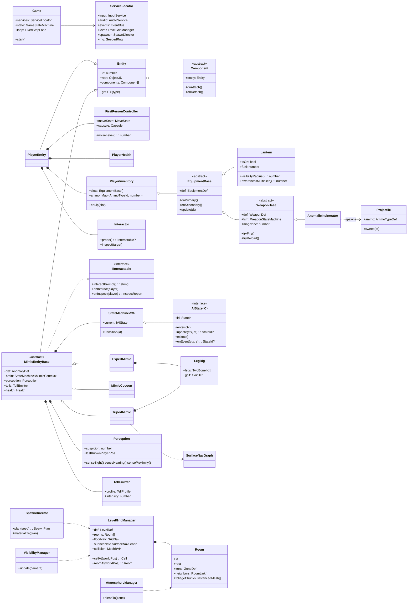
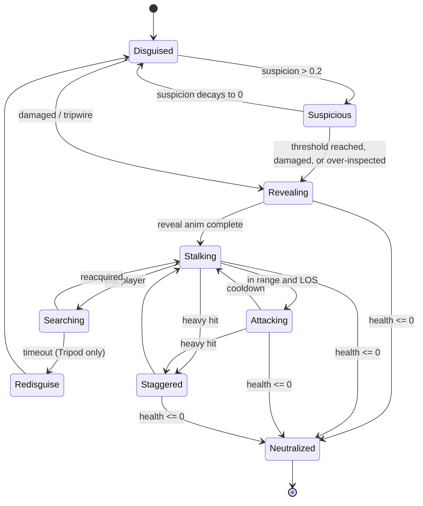
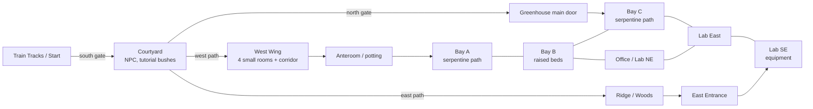

# Greenhouse Anomaly — Phase 1 Technical & Gameplay Architecture

Status: **DRAFT for review** — no code written yet. Decisions marked **[D#]** are the ones that need sign-off; open questions are collected in §9.

Concept references: [`concept/key-art.jpg`](concept/key-art.jpg), [`concept/map-survey.jpg`](concept/map-survey.jpg).

---

## 0. Constraints that drive the design

| Constraint | Consequence |
|---|---|
| Final deliverable is **one HTML artifact** running in a browser iframe | Single-file build; every asset inline or procedural; total size budget matters; no server. |
| Artifact pages may load scripts only from a few CDNs, and inline everything else | Bundle all JS into the HTML instead of relying on runtime CDN imports. No external asset hosting. |
| Runs inside an **iframe** on claude.ai | Pointer Lock and AudioContext autoplay are not guaranteed — needs an early spike and a fallback (see §8.1). |
| Target hardware is "whatever a reviewer opens it on" | Budget for integrated GPUs (Intel Iris Xe / Apple M1 base) at 60 fps, with dynamic resolution. |
| Horror/investigation pacing, tight corridors, dense foliage | Visibility is mostly *designed to be limited* (fog, darkness). That's what keeps rendering cheap: we can cull hard behind fog. |

---

## 1. Technology stack

### [D1] Engine: **Three.js** (r17x, pinned), not Babylon.js / PlayCanvas

| | Three.js | Babylon.js | PlayCanvas |
|---|---|---|---|
| Min bundle (gz) | ~170 KB core | ~1 MB+ core | ~400 KB, editor-centric |
| Render pipeline control (custom wind shader, fog volumes, tells) | Full, low friction | Good, more ceremony (NodeMaterial/ShaderMaterial) | Good |
| Batteries included (physics, audio, GUI, occlusion queries) | No — pick libs | Yes | Partial |
| Single-file offline build | Trivial | OK, heavier | Awkward (cloud editor workflow) |

Rationale: the game needs bespoke rendering (shared wind field with desync'd mimics, emissive tells, fog zones) more than it needs a general physics/GUI stack. Babylon is the credible alternative if we'd rather buy than build occlusion queries and an audio engine; cost is ~5× bundle and a more opinionated scene graph.

### [D2] Supporting libraries (all bundled, versions pinned)

| Concern | Choice | Why |
|---|---|---|
| Collision & raycasts | **three-mesh-bvh** | Capsule-vs-static-world character collision and fast raycasts (projectiles, line of sight, audio occlusion) without a physics engine. |
| Physics | **None in Phase 1** | Nothing in scope needs rigid bodies. Revisit (Rapier, `@dimforge/rapier3d-compat`) if Phase 2 adds throwables/debris. |
| Post-processing | **pmndrs `postprocessing`** | Merges bloom + vignette + grain + tone mapping into few passes; cheaper than three's stock `EffectComposer` chain. |
| Debug UI | **lil-gui** + **stats.js** (dev builds only, tree-shaken out of release) | Live tuning of AI/tell/weapon numbers. |
| HUD / dialogue / menus | **Plain DOM + CSS over the canvas** | Cheap, crisp text, accessible; no in-WebGL UI. |
| Audio | **Web Audio API directly** (HRTF `PannerNode`, `BiquadFilter`) | Need per-source occlusion filtering and voice priority; three's `PositionalAudio` wrapper is too thin to help. |

### [D3] Toolchain

- **TypeScript (strict) + Vite**; **`vite-plugin-singlefile`** emits `dist/index.html` with JS/CSS inlined → that file is what gets published as the artifact.
- **Vitest** for pure-logic units (FSMs, weapon state, grid parser, spawner constraints).
- **Playwright** (Chromium is pre-installed in the dev container) smoke test against the built single file: boots, no console errors, scripted walk + fire, samples frame time.
- ESLint + Prettier; CI runs typecheck → unit → build → smoke → size check.

### [D4] Assets: procedural first, glTF-ready

Phase 1 generates geometry, textures (canvas → `CanvasTexture`) and most SFX procedurally at boot. Keeps the single file small (< 3 MB target) and avoids an asset pipeline before the gameplay is proven. All creation goes through factories (`PlantFactory`, `MimicFactory`, `AudioBank`) so Phase 2 can swap in authored glTF (Draco/KTX2, inlined as base64 or published as artifact side-files) without touching gameplay code.

Risk: procedural audio can sound cheap. Mitigation: allow a small set of CC0 samples (< 500 KB total, Opus-encoded, base64) if synthesis doesn't sell the horror in M4.

### [D5] Art direction approximation

The key art is inked/comic-shaded. Phase 1 approximates it with: toon-ramp lighting (custom `onBeforeCompile` on `MeshStandardMaterial` or `MeshToonMaterial`), inverted-hull outlines **only on mimics, palms, NPC and weapon** (not on foliage — too costly), purple/teal emissive accents, bloom, film grain, vignette, heavy exponential fog. Full-screen edge-detection outlines are deferred — expensive and noisy on foliage.

---

## 2. Runtime architecture

### 2.1 Pattern: composition + ordered systems, not a full ECS

Entity counts are small (≤ ~40 dynamic actors, thousands of *instanced* static plants that are not entities). A full ECS (bitECS) buys cache efficiency we don't need and costs debuggability. Instead:

- **`Entity`** — owns a `THREE.Object3D` root and a list of `Component`s.
- **`System`** — iterates components of a kind in a fixed order each simulation tick.
- **`ServiceLocator`** (`Game.services`) — singletons: input, audio, level, spawner, event bus.
- **Typed `EventBus`** — decouples gameplay events (`NoiseEmitted`, `ProjectileHit`, `MimicRevealed`, `PlayerDamaged`) from listeners (AI perception, audio, HUD, analytics).

### 2.2 Game loop

- **Fixed 60 Hz simulation** (accumulator, max 5 steps/frame, `dt` clamped after tab switches) — keeps AI, projectile sweeps and tell animations framerate-independent.
- **Variable render** with interpolation of actor transforms.
- `visibilitychange` → auto-pause; AudioContext suspended.

Tick order: `Input → PlayerController → Equipment → Projectiles → Perception → AI → Locomotion(IK) → Triggers/Interaction → Spawner → Audio → Culling → Render → HUD`.

### 2.3 Top-level game state machine

`Boot → Title → (ClickToStart: acquires pointer lock + resumes audio) → Playing ⇄ Paused | Dialogue | Inspecting → Dead | Victory → Title`

### 2.4 Class diagram & hierarchy



### 2.5 Source layout (proposed)

```
src/
  main.ts                 boot, renderer, loop
  core/                   Entity, Component, EventBus, FixedStepLoop, SeededRng, StateMachine
  input/                  InputService (pointer-lock + drag-look fallback), bindings
  player/                 FirstPersonController, PlayerHealth, PlayerInventory, Interactor
  equipment/              EquipmentBase, Lantern, WeaponBase, AnomalicIncinerator, Projectile
  ai/
    fsm/                  IAIState, shared states (Disguised, Suspicious, Revealing, ...)
    perception/           sight/hearing/proximity, NoiseEvent
    locomotion/           LegRig, TwoBoneIK, GridNav (A*), SurfaceNavGraph
    mimics/               ExpertMimic, TripodMimic, MimicCocoon
    tells/                TellEmitter, tell channels
  level/                  LevelGridManager, parser, geometry builders, VisibilityManager, AtmosphereManager
  spawn/                  SpawnDirector, constraint solver
  render/                 materials (wind, toon, glass), post-processing, outline
  audio/                  AudioService, voice manager, occlusion, procedural synth bank
  ui/                     HUD, dialogue, menus (DOM)
  data/                   *.def.ts — all tuning data (see §3)
  debug/                  lil-gui panels, gizmos (stripped from release)
tests/                    vitest units; e2e/ playwright smoke
```

---

## 3. Data schemas ("ScriptableObject" equivalents)

Unity ScriptableObjects map to **typed, frozen TS data modules** (`satisfies` the schema so typos are compile errors), hot-reloaded by Vite in dev and exposed to lil-gui for live tuning. No runtime JSON loading in Phase 1 — it's all in the bundle anyway. IDs are string-literal unions so references between defs are type-checked.

### 3.1 Equipment & weapons

```ts
type AmmoTypeId = 'anti_chemical' | 'anti_chemical_concentrate';

interface AmmoTypeDef {
  id: AmmoTypeId;
  displayName: string;
  projectile: {
    speed: number;          // m/s
    gravity: number;        // m/s², small arc
    radius: number;         // swept-sphere radius, m
    maxLifetime: number;    // s
  };
  impact: {
    directDamage: number;
    splashRadius: number;   // m
    splashDamage: number;
    burn?: { dps: number; duration: number };  // damage-over-time on mimics
    noiseRadius: number;    // m — alerts mimics (feeds Perception)
  };
  pickupAmount: number;     // per bottle on the floor (key art: "anomalic/anti-chemical ammo")
}

interface WeaponDef {
  id: 'anomalic_incinerator';
  magazineSize: number;     // 5
  reserveMax: number;
  fireInterval: number;     // s between shots
  reload: { duration: number; interruptible: boolean; perRound: boolean };
  spread: { hip: number; ads?: number };  // radians
  recoil: { pitch: number; yaw: number; recovery: number };
  compatibleAmmo: AmmoTypeId[];
  noiseOnFire: number;      // m
}

interface LanternDef {
  id: 'lantern';
  light: { intensity: number; distance: number; angle: number; penumbra: number; castsShadow: true };
  fill: { intensity: number; distance: number };       // small unshadowed point light
  fuelSeconds: number | null;                           // null = infinite in Phase 1
  awarenessMultiplierOn: number;                        // >1: mimics notice you more
  awarenessMultiplierOff: number;                       // <1
  tellRevealBonusWhenOff: number;                       // bioluminescent tells read better in the dark
}
```

Weapon state machine: `Ready → Firing(cooldown) → Ready`, `Ready → Reloading → Ready`, `Ready(mag=0) → Empty`, any → `Holstered`. Pure TS, unit-tested, no Three.js dependency.

### 3.2 Anomalies

```ts
type AnomalyId = 'expert_mimic' | 'tripod_mimic' | 'mimic_cocoon';
type DisguiseKind = 'palm' | 'small_plant' | 'moth' | 'hanging_pod';

interface AnomalyDef {
  id: AnomalyId;
  health: number;
  threatCost: number;            // spawn budget units
  disguises: DisguiseKind[];
  perception: {
    sightRange: number; sightFovDeg: number;
    hearingMultiplier: number;
    proximityRadius: number;      // instant suspicion bump inside this
    suspicionGainPerSec: number; suspicionDecayPerSec: number;
    revealThreshold: number;      // 0..1
  };
  reveal: { duration: number; interruptibleByDamage: boolean };   // the fairness window
  locomotion: {
    mode: 'stationary_unfold' | 'surface_crawl' | 'none';
    moveSpeed: number; turnSpeed: number;
    navClearance: 'small' | 'large';   // large agents can't fit through doors
  };
  attack: { range: number; windup: number; damage: number; cooldown: number };
  weaknesses: { burnMultiplier: number };
  tells: TellProfile;
  variant: ExpertMimicParams | TripodMimicParams | CocoonParams;
}

interface TellProfile {
  // Every mimic has >= 2 channels so no tell is single-sense (colour-blind / muted play).
  sway?:   { phaseOffset: number; amplitudeScale: number; counterWind: boolean };
  breath?: { period: number; scaleAmplitude: number };
  glow?:   { color: string; baseIntensity: number; pulsePeriod: number; visibleOnlyInDark: boolean };
  spores?: { ratePerSec: number; color: string };
  audio?:  { cue: SfxId; interval: [number, number]; audibleRadius: number; requiresStillness: boolean };
  eyeBlink?: { interval: [number, number] };  // key-art palm has eyes in the trunk
}

interface ExpertMimicParams { kind: 'expert'; legCount: 4; legLength: number; unfoldHeightGain: number; reach: number }
interface TripodMimicParams { kind: 'tripod'; ceilingAmbushChance: number; dropAttackRadius: number; fleeHealthFraction: number }
interface CocoonParams     { kind: 'cocoon'; tripwireRadius: number; lanternExposureToTrigger: number;
                             spawns: { anomaly: 'tripod_mimic'; count: [number, number] }; sporeCloud: { radius: number; duration: number } }
```

### 3.3 Level & zones

```ts
interface LevelDef {
  id: 'greenhouse_estate';
  cellSize: 1;                       // metres
  rooms: RoomDef[];
  links: RoomLinkDef[];              // doors, gates, glass adjacency (for visibility/audio)
  playerStart: Vec3;
  objectives: ObjectiveDef[];
}

interface RoomDef {
  id: RoomId;
  rect: { x: number; z: number; w: number; d: number };   // in cells
  height: number;
  walls: { n: WallKind; s: WallKind; e: WallKind; w: WallKind };  // 'brick' | 'glass' | 'fence' | 'none'
  roof: 'glass' | 'solid' | 'open';
  zone: ZoneId;
  layout: string[];                  // per-cell ASCII rows, see legend below
}

interface ZoneDef {
  id: ZoneId;
  fog: { color: string; density: number };
  ambientLight: number;
  wind: { strength: number; gustiness: number };
  audioBed: SfxId;
  spawnTable: SpawnTableId;
}
```

**[D6] Level encoding: room rectangles + per-room cell layer.** The blueprint is fully rectilinear, so rooms are rects with per-side wall kinds; the interior is an ASCII cell grid. This gives us the room graph (culling, audio occlusion, AI territory) for free and keeps thin glass walls on room edges instead of wasting cells on them.

Cell legend (draft):

```
.  floor (soil/tile)     =  stone path          #  planter / raised bed (collides, low)
T  palm slot             p  small-plant slot    c  ceiling hook slot (cocoons, tripod perches)
D  desk/lab prop         L  lantern/ammo pickup slot     N  NPC   S  player start
x  blocked/dense foliage (collides)   ~  overgrowth (walkable, slows, blocks sight)
```

Example — a winding-path room like the west greenhouse bay:

```
"##..T....p##",
"#.====....p#",
"#.=..=..x..#",
"#.=..=====.#",
"#c=......=.#",
"#.====...=T#",
"#....=====.#"
```

### 3.4 Spawn tables

```ts
interface SpawnTableDef {
  id: SpawnTableId;
  threatBudget: [min: number, max: number];
  slots: Partial<Record<SlotKind, SlotRule>>;     // keyed by layout char: 'T' | 'p' | 'c'
  constraints: {
    minMimicSpacing: number;          // m
    safeRadiusFromEntrances: number;  // no ambush on the doorstep
    maxPerRoom: Partial<Record<AnomalyId, number>>;
    guarantee?: { anomaly: AnomalyId; atLeast: number }[];
  };
}

interface SlotRule {
  options: { result: { prop: PropId } | { anomaly: AnomalyId }; weight: number }[];
}
```

Example: palm slot in the greenhouse → `{ prop: 'palm' }` weight 70, `{ anomaly: 'expert_mimic' }` weight 30, guarantee ≥ 1 expert mimic per run.

---

## 4. Module A — Core FPS & interaction

### 4.1 Player controller
- **Kinematic capsule** (r = 0.3 m, h = 1.7 m; crouch h = 1.1 m) against a **merged static collision mesh with BVH**, using the iterative capsule–triangle push-out approach from three-mesh-bvh's character example. Collision geometry is a *separate, simplified proxy* (walls, planters, trunks, desks) — foliage leaves never collide.
- Speeds (starting points): walk 2.6 m/s, sprint 4.5 m/s (limited by stamina), crouch 1.4 m/s. Ground snapping on the 0.2 m step height for planter edges and the courtyard → greenhouse threshold.
- Corridor feel: 0.3 m radius fits the ~1.2 m serpentine paths with room for a mimic leg; camera near plane 0.05 m so the weapon and foliage don't clip; weapon rendered in a separate overlay pass (own camera, depth cleared) so it never pokes into walls.
- **Noise output** per movement state (sprint loud, crouch near-silent) is published to `Perception` — this is the stealth lever.
- Head bob and lean are cosmetic, camera-only; can be disabled (motion-sickness setting).

### 4.2 Equipment
- `PlayerInventory` with two slots in Phase 1: lantern (left hand, toggle `F`) and incinerator (right hand). Both usable simultaneously — matches key art.
- **Lantern [D7]:** one shadow-casting **SpotLight** in the look direction (single shadow map, 1024²) + a small unshadowed PointLight for close fill. A shadowed point light would cost 6 shadow renders per frame — not affordable. Lantern drives two gameplay values: `visibilityRadius` (fog falloff tightens when off) and `awarenessMultiplier` (mimics notice a lit player sooner). Glow-based tells are only readable with the lantern **off** → core risk/reward loop: *light keeps you safe from ambush, darkness reveals what's lying to you.*
- **Anomalic Incinerator:** 5-round magazine, slow cadence (~0.8 s), canister reload (~2.2 s, interruptible, progress lost). Projectiles are slow visible globs: swept-sphere raycast each tick (no tunneling), slight arc, splash + burn DoT. Hitting a real plant **wastes a round and emits noise** — misidentification has a cost. Glass stops projectiles (crack decal). Ammo bottles are scarce pickups placed by the spawner.

### 4.3 Scan / inspect
- `Interactor` raycasts from screen centre (2.5 m) each tick against interactables (layer-masked).
- **Tap E** = interact (NPC, pickups, doors). **Hold E (1.5 s)** = inspect a plant: camera zooms slightly, HUD shows an `InspectReport` of *observations*, not a verdict ("leaves move against the draft", "faint warmth at the trunk", "nothing unusual"). Mimic reports surface its tell channels with noise; real plants occasionally produce a benign false positive (wilted leaf rustle) so the scan can't be read mechanically.
- Inspecting a mimic **raises its suspicion** quickly; at threshold it reveals at point-blank range. So inspection is information you pay for with risk.

---

## 5. Module B — Anomaly & mimic AI

### 5.1 State machine

Base states from the brief, plus the transitional states needed for fairness and readability:



Mapping to the brief: `IDLE/PLANT_DISGUISE` = Disguised; `ALERT/SUSPICION` = Suspicious (+ Revealing); `STALKING/AGGRO` = Stalking/Attacking/Searching; `NEUTRALIZED` = Neutralized.

Implementation: flat FSM with shared state classes parameterised by `AnomalyDef`; variants override specific states (e.g. `TripodStalkingState`). `IAIState.update` returns the next state id or `null` — transitions are data-visible and unit-testable without rendering. If states multiply in Phase 2, promote to a hierarchical FSM; a behaviour tree is not warranted yet.

**Perception** (runs at 10 Hz, staggered across mimics): sight = cone + range × lantern multiplier + LOS raycast against the BVH (foliage `~` cells add partial occlusion); hearing = `NoiseEvent`s from the bus, attenuated by room-graph distance; proximity = radius check. All feed one `suspicion` scalar with gain/decay.

**Fairness rule:** a mimic only enters `Revealing` if the player can see it *or* an audible reveal cue plays (unfolding wood creak). The reveal duration (≥ 0.8 s) is the player's reaction window. No off-screen instant hits.

### 5.2 Variants

| | Expert Mimic | Tripod Mimic | Mimic Cocoon |
|---|---|---|---|
| Disguise | Palm tree in a `T` slot | Moth resting on foliage, or small plant (`p`) | Hanging pod on a `c` ceiling hook |
| Reveal | Trunk eyes open, 4 root-legs unfold, rises ~1.5 m | Wings fold, spider legs extend, rabbit-ear silhouette | Pulses for ~1.5 s, then bursts |
| Movement | Slow stride on floor grid (A*, `large` clearance — **can't pass doorways**, territorial to its room) | Fast; crawls floor, walls and the glass roof via `SurfaceNavGraph`; drops on the player from `c` nodes | None |
| Threat | High damage, long reach, tanky (3–4 shots) | Low HP (1 shot), hit-and-run, flees and re-disguises at low HP | Spawns 1–2 Tripods + spore cloud (fog spike) |
| Counterplay | Leave its room; burst it during reveal | Track it on the ceiling by sound; keep lantern on | Burn it pre-emptively (costs ammo) or sneak under crouched |

**Locomotion:** procedural legs — each leg is a two-bone analytic IK chain with a foot target planted on the surface; a gait controller lifts the foot farthest from its rest position (classic procedural spider). No skinned animation needed in Phase 1, and it reads well for both the stilt-palm and the spider-moth in the key art.

**`SurfaceNavGraph`:** generated from room geometry — nodes on floor cells, along wall mullions, and on the glass roof frame (matches the greenhouse frame in the art); edges with surface normals. Tripods move node-to-node and orient to the edge normal. Much cheaper and more robust than a true 3D navmesh.

### 5.3 Distinction system (tells)

Principle: every mimic always emits **at least two tells on different senses**, at low intensity, scaled up by suspicion. Real plants share a single global wind field.

| Channel | Real plant | Mimic | Implementation |
|---|---|---|---|
| Sway | Global wind uniform, coherent with neighbours | Phase-offset, counter-wind, or "breathing" scale | Same vertex shader; per-instance attributes `windPhase`, `breath` |
| Glow | None (bioluminescent mushrooms are decoys) | Faint purple vein/eye glow, pulsing; washed out by lantern | Emissive mask × uniform; lantern-on lowers it |
| Spores | Ambient teal motes everywhere | Denser purple spores near the body | GPU points, one draw per room |
| Audio | Leaf rustle with wind gusts | Clicks/breathing, only audible within ~6 m and loudest when the player is crouched and still | Positional voice, gated (see §7.2) |
| Micro-motion | None | Eye blink in trunk, a leg twitch on gusts | Occasional animation event |

Decoys keep it honest: some real palms are crooked, some mushrooms glow teal. The NPC briefing teaches the purple-vs-teal distinction in the courtyard.

---

## 6. Module C — Level geometry & layout

### 6.1 Zone graph (from the map survey)



Room ids and connectivity are provisional; they will be confirmed when the full `LevelDef` is authored in M2.

### 6.2 Geometry generation
`LevelGridManager` turns `LevelDef` into:
1. **Render geometry** per room: walls/frames/planters merged into one mesh per material per room (`BufferGeometryUtils.mergeGeometries`); glass panes one mesh per room.
2. **Collision proxy**: one merged mesh for the whole level → BVH.
3. **Foliage**: `InstancedMesh` per plant type **per room chunk** (so frustum culling works per chunk; bounding spheres computed per chunk).
4. **Nav**: floor `GridNav` (A* on walkable cells, two clearance classes) and `SurfaceNavGraph`.
5. **Spawn slots** from the `T/p/c/L` cells.

### 6.3 Visibility & atmosphere
- **Fog:** custom exponential fog with per-zone density blended by `AtmosphereManager` on room change (courtyard light mist → greenhouse dense). Far plane = fog full-opacity distance (~25 m inside), which is what makes culling cheap.
- **Glass [D8]:** *no true refraction* — `MeshPhysicalMaterial.transmission` re-renders the scene and would roughly double frame cost. Instead: a cheap glass shader (fresnel tint, env-map reflection of a low-res night sky cube, grime/crack texture). Rendered last, `depthWrite: false`. Broken panes are holes in the mesh (and Tripod entry points).
- **Shadows:** only the lantern casts; shadow caster layer limited to mimics, palms, planters, the NPC. Small foliage doesn't cast (alpha-tested shadows are expensive). Moonlight is unshadowed directional fill.
- **Post:** bloom (threshold tuned so tells stay *subtle*), vignette, grain, ACES tone mapping.

### 6.4 Spawner
`SpawnDirector.plan(seed)` is **pure and deterministic** (seeded mulberry32; seed shown in pause menu for bug reports):
1. Collect slots per room → 2. weighted pick per slot → 3. enforce constraints (spacing, safe radius at entrances, per-room caps, guarantees, threat budget) via repair passes → 4. **validate** that a floor path exists from each entrance to every objective with no `large` mimic blocking a doorway → reroll on failure (bounded, falls back to a hand-authored safe plan) → 5. place ammo pickups inversely to threat density.
`materialize(plan)` builds props/entities. Unit tests run the planner over 10 000 seeds and assert constraints.

---

## 7. Edge cases & performance

### 7.1 Occlusion & culling in dense foliage [D9]
Glass walls break classic cell-and-portal culling (you *can* see through them), so instead:
1. **Room-graph + fog-distance culling:** render the player's room, plus rooms reachable through links whose nearest point is within the fog far distance. Everything else `visible = false` (zero cost). With 25 m fog, this is typically 2–4 rooms.
2. **Per-chunk frustum culling** for instanced foliage (above).
3. **Distance LOD for foliage:** beyond ~12 m, swap ferns to a cheaper cross-quad mesh; beyond fog, culled.
4. **No GPU occlusion queries** in Phase 1 (WebGL2 queries are async and add latency/complexity; fog already gives us the bound).
5. Alpha-tested leaves use `alphaTest` (not blending) to avoid sorting and overdraw blowups; draw opaque front-to-back.

Budgets (integrated GPU, 1080p): ≤ 150 draw calls, ≤ 500 k triangles, 1 shadow map, ≤ 3 post passes, JS sim ≤ 4 ms/frame. **Dynamic resolution**: scale pixel ratio 0.6–1.0 based on a rolling frame-time average. Quality presets (Low / Med / High) toggle shadows, bloom, foliage density.

### 7.2 Spatial audio for hidden mimics
- HRTF `PannerNode` per active voice, inverse distance model; **voice manager** caps concurrent positional voices at ~12, prioritised by state (revealed > suspicious > disguised) and distance.
- **Occlusion:** at 10 Hz per voice, raycast listener → source against the collision BVH; solid walls → low-pass (~800 Hz) + −9 dB; glass → mild low-pass + −3 dB; smoothed to avoid zipper noise. Room-graph distance used for hearing perception, so sound "travels" through doors rather than through walls.
- **"Listening" mechanic:** crouched and still for > 1 s ducks the ambient bed by ~6 dB and raises tell-cue gain — the player can deliberately listen for clicks.
- Disguised-mimic cues must be *below* ambient until within ~6 m, otherwise players locate mimics by sound alone from across the map.
- Reveal cues are never culled by the voice cap (fairness).

### 7.3 Other edge cases
| Case | Handling |
|---|---|
| Projectile tunneling through thin glass/legs | Swept sphere per tick against BVH + mimic hit capsules. |
| Player wedged by a mimic in a 1.2 m corridor | Mimic hit capsules push the player (soft), never pin; Expert can't enter corridors. |
| Mimic spawns blocking the only route | Spawner path validation (§6.4). |
| Mimic reveals off-screen / behind player | Fairness rule (§5.1): audible cue required, attack windup ≥ 0.6 s. |
| Cocoon spawn chain overwhelms the slice | Global live-Tripod cap (e.g. 4); cocoons in range of a cap hit stay dormant. |
| Tripod on the glass roof sorts wrong vs glass | Glass rendered last with depthWrite off; Tripods opaque → correct. |
| Shooting a real plant | Round spent, noise event; plant burns (visual), no other penalty. |
| Tab hidden / huge `dt` | Auto-pause, clamp, max sim steps. |
| Pointer lock unavailable or released (Esc) | Pause + "click to resume"; drag-to-look fallback (§8.1). |
| Lantern-off tells = colour reliance | Every mimic has a non-visual or motion tell too. |
| Settings persistence | `localStorage` wrapped in try/catch; game works without it. |
| WebGL2 unavailable | Clear error screen; no WebGL1 path. |

---

## 8. Phase 1 roadmap

### 8.0 Risk spikes (first 1–2 days, before M1 proper)
1. **Pointer Lock + AudioContext inside the published artifact iframe.** Publish a 50-line test page. If pointer lock is blocked → ship a drag-to-look mode (mouse-held look, or click-to-toggle look mode) as the primary control. This decides the input design, so it goes first.
2. **Single-file size & boot time** with three + postprocessing + three-mesh-bvh bundled (expect ~350 KB gz).
3. **Foliage stress test:** 5 000 instanced alpha-tested leaves + fog + one shadowed spotlight on an integrated GPU.

### Milestone 1 — Foundation & player
- Repo scaffold (Vite/TS/singlefile/Vitest/Playwright/CI), core (`Entity`, `EventBus`, `FixedStepLoop`, `SeededRng`, `StateMachine`), game state machine, title/pause DOM UI.
- `InputService` with rebindable bindings and the fallback look mode.
- `FirstPersonController` (walk/sprint/crouch/stamina, capsule-BVH collision, step snapping) on a **hand-built greybox** of one greenhouse bay with a 1.2 m serpentine path.
- Debug panel, stats overlay, frame-time logging.
- **Exit:** walk/sprint/crouch through the greybox inside the published artifact at 60 fps; collision never sticks or tunnels in the Playwright walk script.

### Milestone 2 — Level, lighting & atmosphere
- `LevelDef` authored for the whole map (Start → Courtyard → West Wing → Greenhouse bays → Labs → East Entrance). Parser + geometry builders + collision proxy + nav grids.
- Procedural plant factory (palm, fern, mushroom, bush, overgrowth), wind vertex shader, instanced per-room chunks.
- Lantern (spot + fill, shadow), fog zones + `AtmosphereManager`, glass shader, post stack, toon shading/outline on hero objects.
- `VisibilityManager` (room-graph + fog culling, LOD), dynamic resolution, quality presets.
- Ambient audio beds per zone, footsteps by surface.
- **Exit:** the full estate is walkable and atmospheric, within budget (§7.1) on the reference integrated GPU.

### Milestone 3 — Equipment, combat & interaction
- `PlayerInventory`, `Lantern` gameplay values, `AnomalicIncinerator` with weapon FSM, projectiles, splash/burn, impact VFX, ammo pickups, HUD (ammo pips, lantern state, health, interaction prompt).
- `Interactor` (tap/hold), `InspectReport` UI, NPC dialogue (static, linear) and objective tracker.
- `PlayerHealth`, damage feedback, death → restart with same/new seed.
- A static **target dummy mimic** to tune shooting before real AI exists.
- **Exit:** talk to NPC, receive incinerator, pick up ammo, inspect plants, shoot/burn the dummy; weapon FSM fully unit-tested.

### Milestone 4 — Anomalies & playable slice
- FSM framework + shared states, `Perception` (sight/hearing/proximity, lantern multiplier), `TellEmitter` with all channels.
- `LegRig` (2-bone IK + gait) → Expert Mimic → Tripod Mimic (+ `SurfaceNavGraph`, ceiling ambush, re-disguise) → Mimic Cocoon (tripwire, burst, spores).
- Spatial audio: voice manager, occlusion, listening mechanic, reveal cues.
- `SpawnDirector` with tables, constraints and path validation; seeded runs.
- Slice loop: arrive by train → NPC briefing + courtyard tutorial (one guaranteed Tripod in the SE bushes, one dormant cocoon) → greenhouse → neutralise all mimics (count unknown to the player; NPC says "at least three") → return to the train. Win/lose screens with run stats.
- Tuning pass, performance pass, accessibility settings (sensitivity, FOV, head-bob off, subtitles for audio tells).
- **Exit:** a 10–15 minute run that is replayable with different seeds; built `dist/index.html` published as the artifact.

---

## 9. Open questions for review

1. **Input fallback:** if pointer lock is blocked in the artifact iframe, is drag-to-look acceptable for the review build, or do you want me to also produce a standalone HTML for full-mouse play?
2. **Assets:** OK with procedural geometry/audio for Phase 1, accepting a "stylised greybox-plus" look rather than key-art fidelity? Or should Phase 1 budget time for a small set of authored glTF hero models (palm mimic, tripod, cocoon)?
3. **Failure model:** permadeath + reroll seed per run (roguelite), or checkpoint at the greenhouse door?
4. **Scan verdicts:** observations only (my recommendation — keeps player judgment central), or an explicit "anomaly detected %" readout?
5. **Lantern fuel:** infinite in Phase 1 (recommended), or a fuel resource from the start?
6. **Platforms:** desktop keyboard+mouse only for Phase 1? Gamepad is cheap to add via the Gamepad API; touch is not.
7. **Expert Mimic territoriality** (can't pass doorways): intended as a design rule, or should it be able to break through glass walls later?
